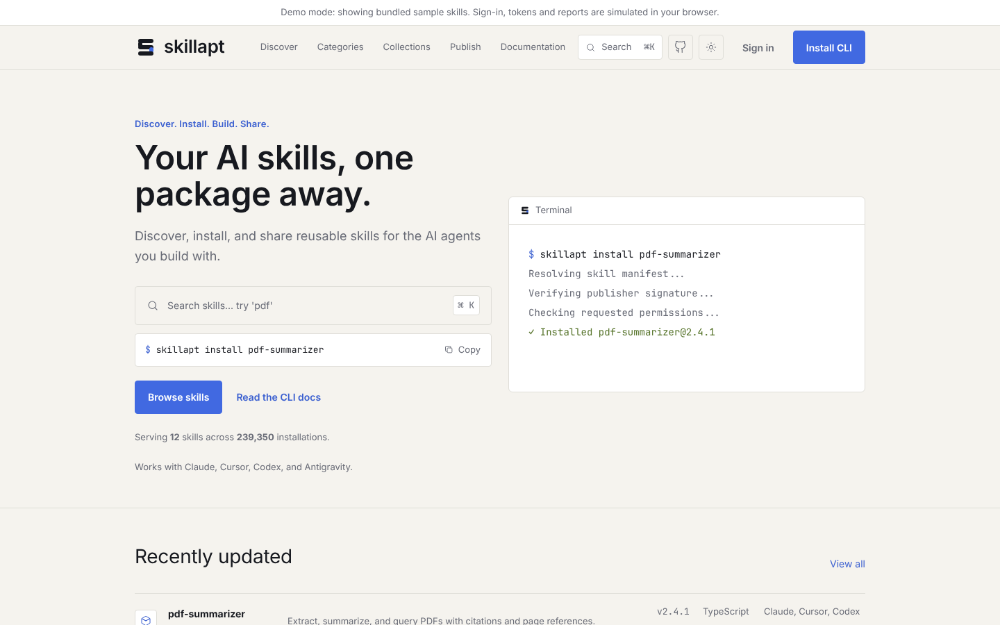
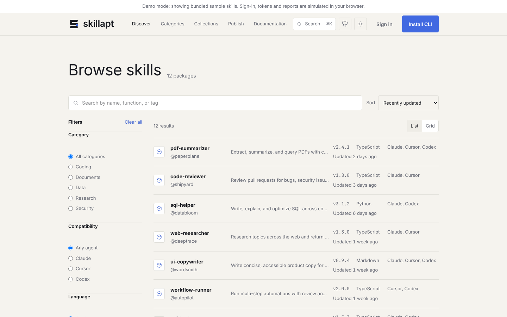
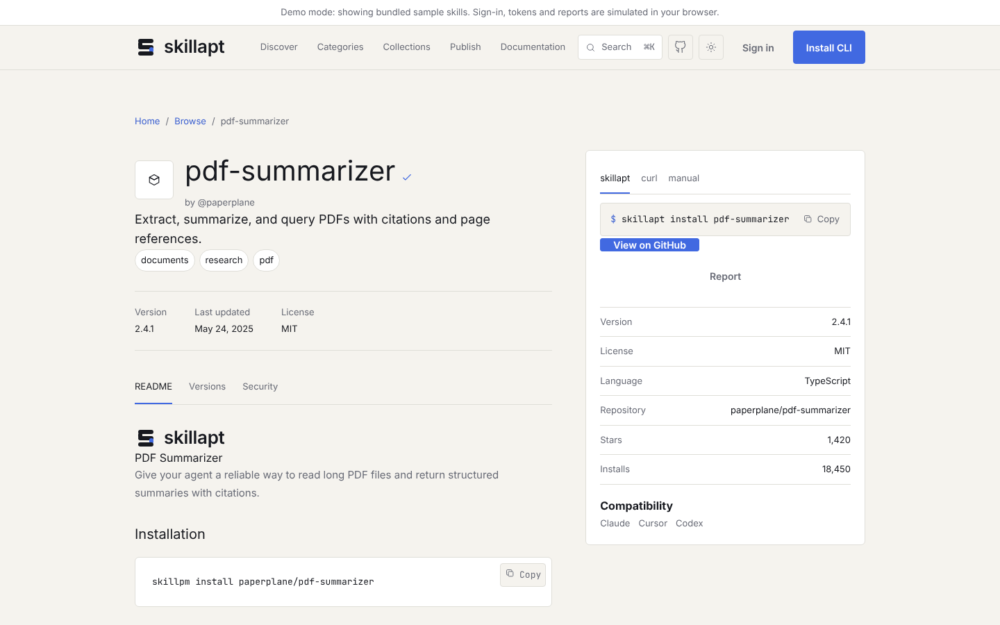
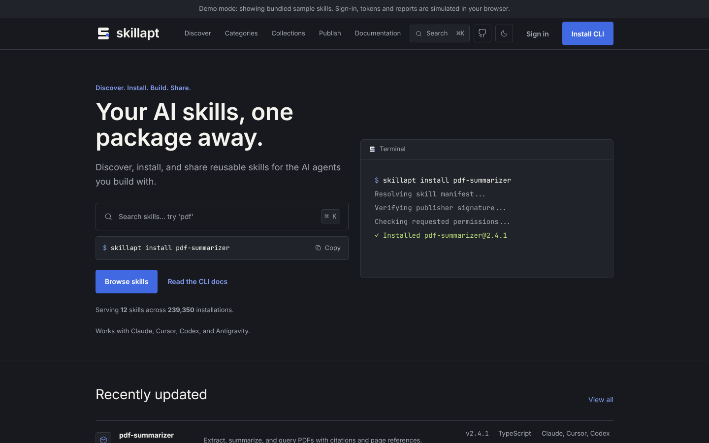

<div align="center">

# skillapt-web

**The web portal for [skillapt](https://github.com/Ankur17nith/skillapt), the package manager and registry for AI agent skills.**

[](https://github.com/Ankur17nith/skillapt-web/actions/workflows/ci.yml)
[](LICENSE)
[](https://nodejs.org/)
[-F38020.svg)](#deploy-to-cloudflare-free)

Browse skills, read the docs, and manage publishing tokens, as a fast static site that costs nothing to host.



</div>

---

## The skillapt project

skillapt is three repositories that work together:

| Repository | What it is |
| :--- | :--- |
| [**skillapt**](https://github.com/Ankur17nith/skillapt) | The CLI. Installs, locks, packs and publishes skills for Claude, Cursor, Codex and Antigravity. |
| [**skillapt-registry**](https://github.com/Ankur17nith/skillapt-registry) | The registry API (Cloudflare Workers + D1 + R2) that stores and serves skill packages. |
| **skillapt-web** (this repo) | The website that talks to the registry API. |

## Features

- **Browse and search**: instant fuzzy search (Fuse.js) with a `⌘K` / `Ctrl+K` command palette, category / compatibility filters, sorting, pagination, and URL-synced filters.
- **Skill pages**: rendered README (GitHub-flavored markdown, no raw HTML), install commands, version history with yank status, security summary, and an abuse-report form.
- **Publisher dashboard** (`/dashboard`): view your skills, yank / restore versions, create and revoke CLI tokens (shown once).
- **Documentation** at `/docs`, rendered from markdown in [`content/docs`](content/docs).
- **Light and dark themes** without a flash of the wrong theme, system preference aware.
- **Secure by default**: strict Content-Security-Policy (`script-src 'self'`), no third-party requests (fonts are self-hosted), no raw HTML rendering, validated registry data.
- **Accessible**: automated axe-core checks (WCAG 2 A/AA) pass on every route in both themes.
- **Demo mode**: with no registry configured the site runs entirely on bundled sample data, so you can develop and preview with zero backend.

## Tech stack

React 19, React Router 7, Vite 8, TypeScript, Tailwind CSS v4, Fuse.js, react-markdown + remark-gfm, react-helmet-async, Vitest + Testing Library. Deployed as static assets on Cloudflare.

## Quick start

Requires **Node.js ≥ 22.12**.

```bash
git clone https://github.com/Ankur17nith/skillapt-web.git
cd skillapt-web
npm ci
npm run dev        # http://localhost:8443, demo mode (bundled sample data)
```

To develop against a registry, copy the example env file and point it at a running registry (see the [registry repo](https://github.com/Ankur17nith/skillapt-registry) for `wrangler dev`):

```bash
cp .env.example .env.local   # then edit VITE_REGISTRY_URL=http://localhost:8787
```

### Scripts

| Script | What it does |
| :--- | :--- |
| `npm run dev` | Vite dev server with hot reload (port 8443) |
| `npm run typecheck` | `tsc --noEmit` |
| `npm test` | Vitest unit and component tests |
| `npm run build` | Production build to `dist/` (also emits `_headers`, `robots.txt`, `sitemap.xml`) |
| `npm run preview` | Serve the production build locally |
| `npm run check` | Typecheck + tests + build (what CI runs) |
| `npm run deploy` | Build and `wrangler deploy` (needs a Cloudflare login) |

## Configuration

All configuration is build-time via `VITE_*` variables (they are baked into the public bundle, so never put secrets here).

| Variable | Default | Description |
| :--- | :--- | :--- |
| `VITE_REGISTRY_URL` | *(unset = demo mode)* | Base URL of the skillapt registry, e.g. `https://skillapt-registry.<your-subdomain>.workers.dev`. Must be `https://` (plain `http://` only for `localhost`). `VITE_API_URL` is still accepted as a legacy alias. |
| `VITE_SITE_URL` | *(unset)* | Public origin of this site, e.g. `https://skillapt-web.<your-subdomain>.workers.dev`. When set, the build emits canonical / Open Graph URLs, `sitemap.xml` and the `Sitemap:` line in `robots.txt`. When unset, no absolute URLs are advertised, which is correct until you have a stable URL. |

The registry URL is also written into the generated CSP `connect-src`, so the browser may only call that one origin.

## Deploy to Cloudflare (free)

You do **not** need a domain, a paid plan, or a credit card. Cloudflare gives every deployment a free `*.workers.dev` URL.

### Option A: Cloudflare dashboard + GitHub (recommended, no secrets in GitHub)

1. Sign up at [dash.cloudflare.com](https://dash.cloudflare.com) (free).
2. **Workers & Pages → Create → Import a repository**, pick `skillapt-web`.
3. Build command: `npm run build`. Deploy command: `npx wrangler deploy`.
4. Under **Variables** add `VITE_REGISTRY_URL` (your deployed registry URL) and, once you know your site URL, `VITE_SITE_URL`.
5. Save and deploy. Your site is live at `https://skillapt-web.<your-subdomain>.workers.dev`. Every push to `main` redeploys.

### Option B: GitHub Actions

The included [`deploy.yml`](.github/workflows/deploy.yml) builds, tests and runs `wrangler deploy` on every push to `main`, but only once you add these in **Settings → Secrets and variables → Actions**:

- Secrets: `CLOUDFLARE_API_TOKEN` (template "Edit Cloudflare Workers"), `CLOUDFLARE_ACCOUNT_ID`
- Variables: `VITE_REGISTRY_URL`, `VITE_SITE_URL`

Without the token the workflow still builds and simply skips the deploy.

### Option C: from your machine

```bash
npx wrangler login
npm run deploy
```

### Connect it to your registry

1. Deploy [skillapt-registry](https://github.com/Ankur17nith/skillapt-registry) first (its `docs/DEPLOY.md` covers D1, R2 and secrets).
2. Set `VITE_REGISTRY_URL` here to the registry URL and rebuild.
3. On the registry, add this site's exact origin to `CORS_ORIGIN`.

> **Cross-site cookie limitation.** The registry's session cookie is `SameSite=Lax`. When the site and the registry live on different registrable domains (for example `*.workers.dev` for both is treated as cross-site), browsers will not send that cookie on the site's API calls. Public browsing works fine; for sign-in and token management, use the registry's own `/dashboard` page (the site links to it). Serving both from one custom domain later removes the limitation.

## Project structure

```
src/
  pages/        route components (Home, Browse, SkillDetail, Docs, Dashboard, ...)
  components/   shared UI (Navbar, SkillCard, CommandPalette, markdown overrides, ...)
  lib/          registry client (api.ts), auth, search, validation, URL/markdown safety helpers
  data/         bundled demo data used when no registry is configured
  config.ts     URL configuration (VITE_REGISTRY_URL / VITE_SITE_URL)
content/docs/   markdown documentation rendered at /docs
public/         static assets and theme-init.js (kept external for the CSP)
docs/           specification and OpenAPI description of the registry API
vite.config.ts  build; emits _headers (CSP), robots.txt, sitemap.xml
wrangler.jsonc  Cloudflare Workers static-assets config (SPA fallback)
```

## Screenshots

| Browse | Skill detail | Dark theme |
| :---: | :---: | :---: |
|  |  |  |

## Security

See [SECURITY.md](SECURITY.md) for how to report a vulnerability privately. Highlights: strict CSP, no raw HTML in markdown, registry data validated before it reaches URLs, `rel="noopener noreferrer"` on external links, no third-party requests.

## Contributing

Contributions are welcome. Please read [CONTRIBUTING.md](CONTRIBUTING.md) and our [Code of Conduct](CODE_OF_CONDUCT.md) first.

## License

[MIT](LICENSE) © 2026 skillapt contributors
